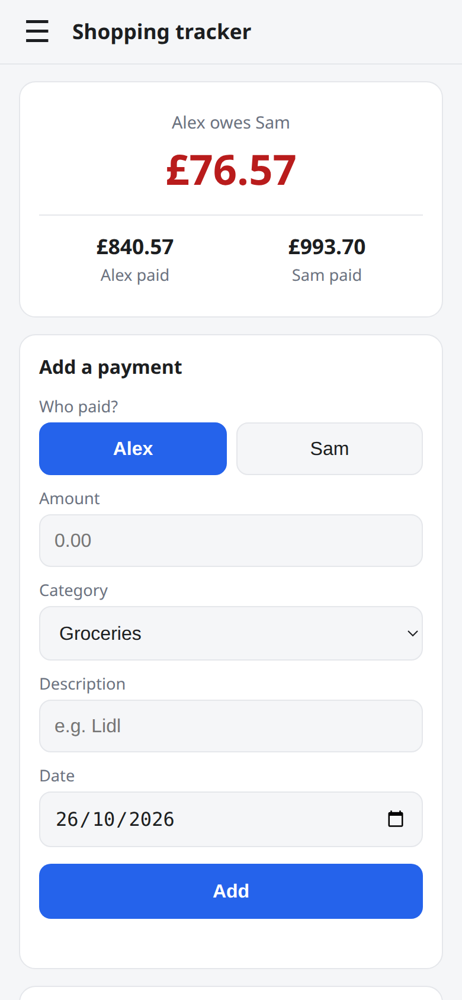
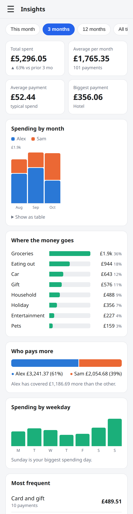
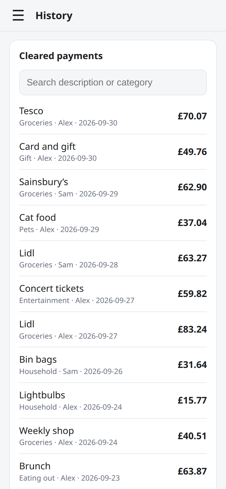
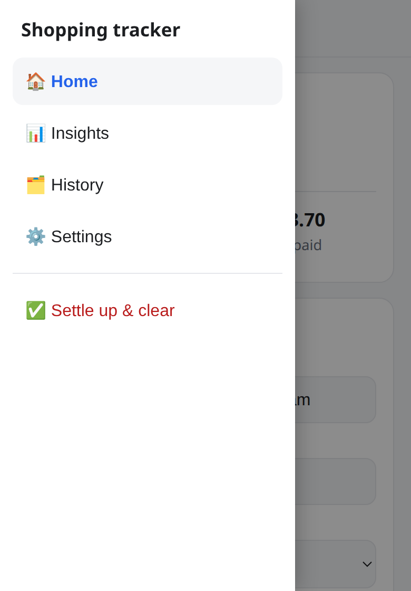

# Shopping tracker

  
  
  
  

*Screenshots use made-up demo data.*

A tiny app for two people to track shared spending and see who owes whom. It splits everything 50/50.

- Works on Android and iOS (it's a web app you add to your home screen)
- Your data lives in **your own Google Sheet**, so there is nothing to host and nothing to pay for
- Everyone uses their own Google account and sets their own names, currency and categories
- **Insights** show spending by month (or day), by category, who pays more, busiest weekday and your most frequent payments, over this month, 3 months, 12 months or all time
- **Everything in Insights is tappable.** Tiles, chart bars and segments, legend, category rows, weekday bars and frequent payments all open a breakdown of the payments behind them. From there you can regroup by category, description, person, month/day, weekday or payment size, and tap a group to drill in further
- A hamburger menu switches between Home, Insights, History and Settings
- "Settle up & clear" (in the menu) moves current payments to a **Cleared** tab and resets the balance

## Set up (about 5 minutes)

1. Create a new Google Sheet at <https://sheets.new>, then **Share** it (Editor) with your partner.
2. In the sheet, open **Extensions → Apps Script**.
3. Replace the contents of `Code.gs` with [`Code.gs`](Code.gs) from this repo.
4. Click **+ → HTML**, name it `Index` (just `Index`, no `.html`) and paste in [`Index.html`](Index.html).
5. Click **Deploy → New deployment → Web app**:
   - **Execute as:** User accessing the web app
   - **Who has access:** Anyone with a Google account
6. Click **Deploy**, authorise when asked, and copy the web app URL.
7. Open the URL on each phone and sign in. Both of you must have access to the sheet.
   - iPhone: Safari → Share → Add to Home Screen
   - Android: Chrome → ⋮ → Add to Home screen

On first open the app asks for your two names, currency symbol and categories. They are saved in a **Settings** tab in your sheet, and you can change them later from the Defaults card. If you rename someone, their existing payments are renamed too.

Also on each phone, in the **Defaults** card, you can pick a default person and a default category.

## Updating

Paste the new code, then **Deploy → Manage deployments → ✏️ → Version: New version → Deploy**. The URL stays the same.

## Privacy

The app runs as whoever opens it and only reads and writes the sheet it is attached to. Only people you share the sheet with can use it; having the link is not enough. There are no servers or analytics.

## Developing

`node dev/build-preview.js` builds `dev/preview.html`, which runs the real `Code.gs` against a fake in-memory sheet seeded with demo data, so you can try the UI in any browser without deploying. Add `?empty` to the URL to see the first-run setup, and `#insights`, `#history` or `#menu` to jump to a view.

## Sheet layout

| Tab | Columns |
| --- | --- |
| Shopping | Date, Person, Amount, Category, Description, ID |
| Cleared | same as Shopping, plus Cleared on |
| Settings | person1, person2, currency, categories |

## Licence

MIT
